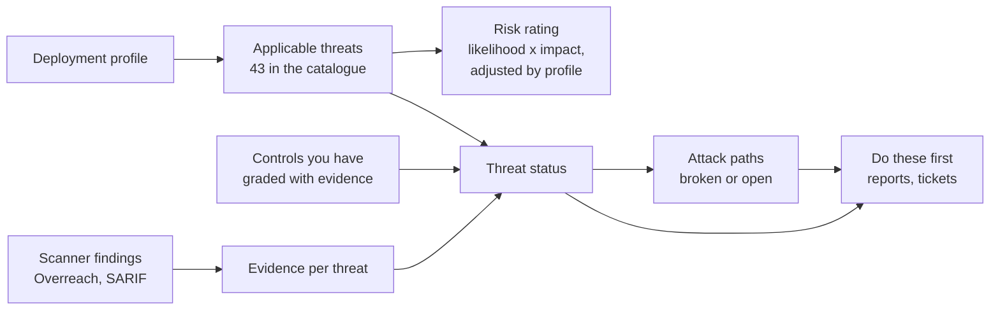

# Agent Threat Workbench

A threat model for AI agents that you can actually work with.

You describe your deployment: where the model runs, how much it may do on its own, who uses it, and what it touches (retrieval, tools, MCP servers, memory, code execution, other agents). The workbench tells you which threats apply, how they chain into attack paths, which controls would break those paths soonest, and what evidence would show a control is real rather than claimed.

**Live:** https://bogdanticu88.github.io/agent-threat-workbench/

Links carry the profile, so you can send someone straight to a view. For example, a multi-tenant agent platform with MCP, replaying the cross-tenant path on the 3D map:
`https://bogdanticu88.github.io/agent-threat-workbench/?h=platform&a=auto&u=multitenant&f=tools,mcp,untrusted,data&view=map&path=AP-4`

## How it works



**Threats.** Each of the 43 threats has a scenario, a base likelihood and impact, the controls that close it, the detections that catch it, mappings to the OWASP Top 10 for LLM Applications 2026, the OWASP Top 10 for Agentic Applications 2026 and MITRE ATLAS, and a linked public case where one exists. A threat only appears when your profile has what it needs: the coding-agent threats need coding agents, the memory threats need memory.

**Controls.** Real defences are not all-or-nothing, so each threat lists controls in three groups: required (all of them), alternatives (any one of them), and controls that also help but are not needed. Some requirements depend on your profile: data leaking between users needs memory isolation if you have memory, retrieval permissions if you have retrieval, and delegated rights if you have tools, each on its own, because one store's isolation says nothing about another's. Indirect prompt injection, for instance, needs tools to run with the user's rights, plus either isolation of untrusted content or removal of risky tools once that content is in context. Each control is graded Not in place, Partial, Implemented or Verified, and Verified only counts when the evidence is written down.

**Status.** A threat is Mitigated when every required control is at least Implemented and every group of alternatives has one. Controls change the status. They never quietly lower the risk rating. Proof outranks checkboxes: if a validated finding shows a threat is exploitable, it is marked Contradicted and stays outstanding, and any path through it stays open, whatever the controls say. Accepting residual risk is recorded with an owner and a review date, and the threat stays outstanding.

**Attack paths.** Seven paths chain threats the way published incidents did, from planted content stealing data to an agent doing damage with no attacker at all. A path applies only when your profile has its prerequisites. It is broken when every applicable threat on any one stage is mitigated. Detection coverage is shown beside each path but never breaks it: an attack that gets logged still happened.

**3D map.** An isometric view of your deployment, built from the profile. Threats stand as columns on the component they hit, coloured by status and sized by risk. Pick a path and a token replays it stage by stage, stopping at a gate where a stage is broken.

**Scanner evidence.** Import [Overreach](https://github.com/bogdanticu88/OverReach) JSON or SARIF, any SARIF 2.1.0 file, or a plain findings list. Evidence grades carry through: reachable on the spec, simulated, or proven. Mappings from Overreach outcomes or an explicit `threats` list count at once. Mappings guessed from rule names are marked as suggestions and count only after you confirm them. A threat marked mitigated that a validated finding proves exploitable is flagged as a conflict.

**Outputs.** A Markdown review report, a threat register CSV, remediation tickets for Jira or ServiceNow, the risk acceptance register, snapshots to show progress between reviews, and a JSON assessment file to save and reload.

## The numbers are judgement

Base ratings, profile adjustments and the "do these first" ranking are an assessment aid, not measurement. The page shows every rule under **Report, Method and weights**, and you can change the weights to fit your own risk method.

## Privacy

One static HTML file. No backend, no cookies. Your answers stay in your browser's local storage. If page analytics are switched on (`ANALYTICS_TOKEN` in `src/app.js`), the page counts visits with Cloudflare Web Analytics, which sets no cookies and never sees what you enter, and the footer says so.

## Working on it

```
src/catalog.js   threats, controls, detections, paths, framework mappings, sourced cases
src/model.js     scoring, status, paths, importers, migration (no DOM, tested)
src/app.js       the page
src/map3d.js     the 3D map (three.js r128 from cdnjs)
src/shell.html   markup and styles
build.mjs        assembles index.html
tests/           node --test, no dependencies
```

```
node build.mjs        # rebuild index.html after editing src/
node --test    # run the model tests
```

CI runs the tests and fails if `index.html` was not rebuilt after a change to `src/`. Saved assessments carry a schema version and older ones are migrated on load.

## Caveats

Version 0.3.1. The framework mappings and public cases were checked in November 2026. Check them against the current releases before you cite them in an audit.

## Want the paths tested for real?

This shows what could go wrong. An assessment shows what actually does. [Bitwise Defence](https://bitwisedefence.com) tests where an agent's authority ends and hands engineers reproducible findings and fixes. contact@bitwisedefence.com

## Licence

MIT
